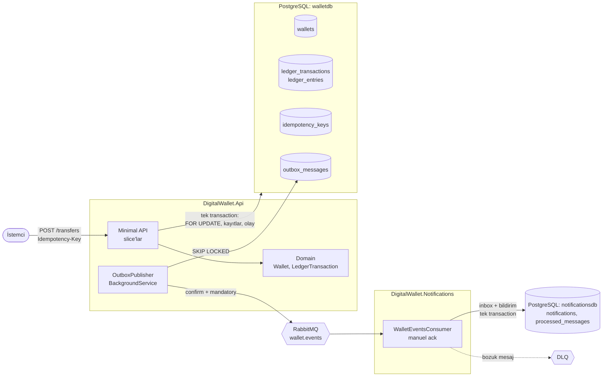

# Dijital Cüzdan — .NET 10 ödeme backend'i

[](https://github.com/Mahanaim-Virgil/digital-wallet/actions/workflows/ci.yml)

> **English summary.** A learning/portfolio project: a digital wallet backend in .NET 10 that focuses on the
> hard parts of payments rather than CRUD — double-entry ledger, row locking against lost updates,
> idempotency keys, a hand-written transactional outbox with RabbitMQ, an inbox-based consumer, and
> end-to-end OpenTelemetry tracing across the outbox. Every claim is backed by an automated test against
> real PostgreSQL and RabbitMQ (Testcontainers) and runs in GitHub Actions. Docs and code comments are in
> Turkish; the [architecture decisions](docs/MIMARI-KARARLAR.md) start with a summary table.

Kullanıcı cüzdan açar, para yatırır ve cüzdanlar arasında transfer yapar. Ürün basit; projenin amacı
ödeme sistemlerinde gerçekten zor olan problemleri doğru çözmek ve her çözümü bir testle kanıtlamak.

## Çözülen problemler

| Problem | Çözüm | Kanıt |
|---|---|---|
| "Bu bakiye neden bu?" sorusu cevaplanamaz, para yoktan var olabilir | **Çift taraflı kayıt (ledger):** her işlem toplamı 0 olan kayıtlar; bakiye kolonu ledger'ın özeti | Her eşzamanlılık testinden sonra tüm DB için defter denetimi |
| Aynı cüzdana paralel istekte güncelleme kaybolur (lost update) | **`SELECT ... FOR UPDATE`**, kilitler id sırasıyla (deadlock yok) | Kilitsiz kodda 50 × 1 TL yatırma **2-4 TL** bıraktı; testler `FOR UPDATE` silinince kırmızı |
| Ağ koptu, istemci isteği tekrarladı → para iki kez gider | **`Idempotency-Key`**, kayıt para hareketiyle aynı DB transaction'ında | Aynı anahtarla 20 eşzamanlı istek → tek para hareketi, 19 tekrar yanıtı |
| "Önce commit, sonra RabbitMQ'ya gönder" olay kaybettirir (dual write) | **Transactional Outbox** (elle), `SKIP LOCKED`, publisher confirm, `mandatory` | RabbitMQ kapalıyken API 201 döner, olay outbox'ta bekler |
| RabbitMQ en az bir kez teslim eder → tekrar mesaj | **Inbox** (`processed_messages`), manuel ack, dead-letter kuyruğu | Aynı mesaj iki kez → tek bildirim; bozuk mesaj DLQ'ya |
| Arka planda yayınlanan olay, isteğin izinden kopar | Outbox satırında **`traceparent`**; yayın orijinal izin çocuğu | Bir transfer tek iz: API → DB → kilit → outbox → RabbitMQ → bildirim servisi |

Her kararın seçenekleri ve takasları: [docs/MIMARI-KARARLAR.md](docs/MIMARI-KARARLAR.md).

## Mimari



Bir transferin yolculuğu:

1. İstek `Idempotency-Key` ile gelir. Anahtar daha önce başarıyla işlendiyse aynı yanıt döner
   (`Idempotent-Replayed: true`), para hareket etmez.
2. Tek bir DB transaction'ında: anahtar satırı yazılır → iki cüzdan **id sırasıyla** `FOR UPDATE` ile
   kilitlenir → domain kuralları (yetersiz bakiye, para birimi) kilitli, güncel satırlarda çalışır → iki
   ledger kaydı (toplam 0), bakiyeler ve **outbox satırı** (o anki `traceparent` ile) yazılır → commit.
3. `OutboxPublisher` ≈1 sn içinde bekleyen satırı alır, olayın izinden bir span açar, RabbitMQ'ya
   gönderir, onay (confirm) gelince satırı işaretler.
4. Bildirim servisi mesajı alır; `message_id` inbox'ta yoksa bildirimi ve inbox satırını tek transaction'da
   yazar, sonra ack'ler. Mesaj tekrar gelirse atlanır; çözülemeyen mesaj dead-letter kuyruğuna gider.

## Teknoloji

.NET 10, ASP.NET Core Minimal API, EF Core 10 + Npgsql (PostgreSQL 18), RabbitMQ 4 (`RabbitMQ.Client` 7),
.NET Aspire 13 (yerel orkestrasyon + dashboard), OpenTelemetry, xUnit v3 + Testcontainers, Docker Compose,
GitHub Actions.

## API

| Uç nokta | Açıklama |
|---|---|
| `POST /wallets` | Cüzdan aç: `{"ownerName": "Ali", "currency": "TRY"}` (TRY, USD, EUR) |
| `GET /wallets/{id}` | Cüzdan ve bakiye |
| `POST /wallets/{id}/deposits` | Para yatır: `{"amount": 100}` — `Idempotency-Key` başlığı zorunlu |
| `POST /transfers` | Transfer: `{"fromWalletId", "toWalletId", "amount"}` — `Idempotency-Key` zorunlu |
| `GET /transactions/{id}` | İşlem ve ledger kayıtları |
| `GET /wallets/{id}/entries?limit=50` | Hesap ekstresi (`balanceAfter` ile) |
| `GET /wallets/{id}/notifications` | Bildirim servisi: cüzdanın bildirimleri |

Hatalar RFC 9457 ProblemDetails: girdi `400`, bulunamadı `404`, iş kuralı `422` + `code`
(`insufficient_funds`, `currency_mismatch`, `idempotency_key_reused`, ...). Tutarlar en fazla 2 ondalık.

## Çalıştırma

### Docker Compose (en kolay)

Gerekenler: Docker.

```bash
cp .env.example .env        # Windows cmd: copy .env.example .env — sonra şifreleri değiştirin
docker compose up --build
```

- API: http://localhost:8080 · Bildirim servisi: http://localhost:8081
- İzler (Aspire dashboard): http://localhost:18888 · RabbitMQ arayüzü: http://localhost:15672

Örnek akış (Git Bash / Linux / macOS):

```bash
bash scripts/smoke-test.sh   # iki cüzdan → yatırma → transfer → bildirimleri bekler
```

### .NET Aspire ile (geliştirme)

Gerekenler: .NET 10 SDK, Docker.

```bash
dotnet run --project src/DigitalWallet.AppHost --launch-profile http
```

Dashboard http://localhost:15115 (giriş bağlantısı konsolda). Aspire PostgreSQL ve RabbitMQ container'larını
başlatır, migration'lar açılışta uygulanır; API http://localhost:5043, bildirim servisi http://localhost:5110.

### Testler

Gerekenler: .NET 10 SDK, Docker (entegrasyon testleri gerçek PostgreSQL ve RabbitMQ başlatır).

```bash
dotnet test --project tests/DigitalWallet.UnitTests/DigitalWallet.UnitTests.csproj
dotnet test --project tests/DigitalWallet.Api.IntegrationTests/DigitalWallet.Api.IntegrationTests.csproj
dotnet test --project tests/DigitalWallet.Notifications.IntegrationTests/DigitalWallet.Notifications.IntegrationTests.csproj
```

74 test: 44 birim, 24 API entegrasyon (eşzamanlılık, idempotency, outbox, migration), 6 bildirim servisi
(inbox, dead-letter). Windows'ta uygulama denetimi test programlarını engelliyorsa
`bash scripts/test-in-docker.sh` testleri Linux SDK container'ında çalıştırır.

## Proje yapısı

```
src/
  DigitalWallet.Api/              Features/<özellik>/<işlem>.cs (endpoint + iş), Domain/, Infrastructure/
  DigitalWallet.Notifications/    RabbitMQ tüketicisi, inbox, kendi veritabanı
  DigitalWallet.Contracts/        servisler arası olaylar ve RabbitMQ adları
  DigitalWallet.ServiceDefaults/  OpenTelemetry, health check, örnekleyici
  DigitalWallet.AppHost/          .NET Aspire
tests/                            birim + entegrasyon (Testcontainers)
docker/, compose.yaml             migrator (EF bundle) ve Compose
docs/MIMARI-KARARLAR.md           9 mimari karar: bağlam, seçenekler, karar, takas
```

## Bilinen eksikler

Bilerek kapsam dışı bırakılanlar: kimlik doğrulama, gerçek banka/kart entegrasyonu, kur dönüşümü, frontend.
Bilinen teknik sınırlar (ayrıntı: [mimari kararlar](docs/MIMARI-KARARLAR.md#açık-kalanlar-bilerek-kapsam-dışı)):
para birimi başına tek sistem cüzdanı nedeniyle yatırmalar sıraya girer (hot row), idempotency/outbox/inbox
tabloları temizlenmiyor, ledger değişmezliği DB tetikleyicisiyle korunmuyor.

## Yapay zeka kullanımı

<!-- Bu bölüm geliştiricinin cevaplarından yazılacak. -->
